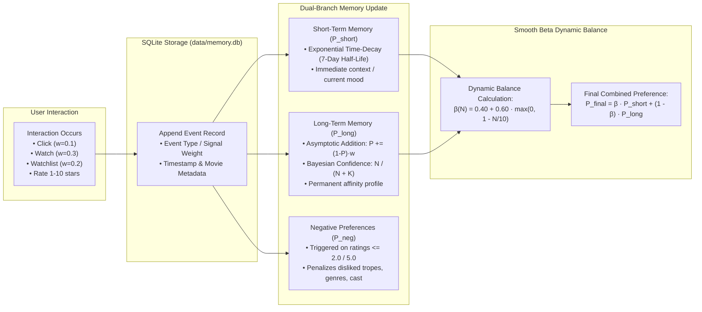
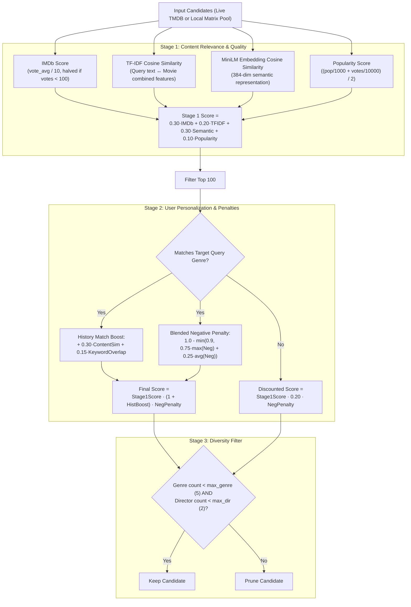
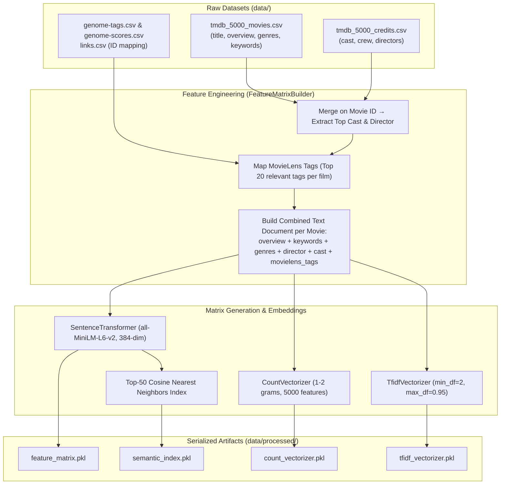

# System Architecture & Flowchart Documentation

This document describes the complete architecture, pipeline flowcharts, memory subsystems, data flow, and module responsibilities of the **Movie Recommender Agent**.

---

## 1. High-Level System Architecture

```
                    ┌──────────────┐      ┌──────────────┐
                    │  CLI (main.py)│      │ MCP server   │      ┌─────────────┐
  User / Agent ─────▶│  Interactive │      │ (FastAPI     │────▶│ A2A agent   │
   or External App  │  & Discovery │      │  :8000)      │      │ (3 caps)    │
                    └──────┬───────┘      └──────┬───────┘      └──────┬──────┘
                           │                     │                     │
                           ▼                     ▼                     ▼
                ┌──────────────────────────────────────────────────────────────┐
                │              Pipeline: MovieRecommender                       │
                │  1. UserMemoryService / PreferenceExtractor → User Profile   │
                │  2. NLFeatureExtractor  → Structured features from NL query   │
                │  3. TMDBClient (or local pool) → Stage-1 Candidates          │
                │  4. MovieRanker.rank_movies_stage1 → Query-similarity rank   │
                │  5. MovieRanker.rank_movies_stage2 → Watch-history boost     │
                │  6. DiversityFilter → De-duplicate genres / directors        │
                │  7. DeepSeekReasoner / TemplateEngine → Explanations         │
                └──────┬───────────────┬───────────────────┬───────────────────┘
                       │               │                   │
                       ▼               ▼                   ▼
                ┌────────────┐ ┌──────────────┐ ┌────────────────────┐
                │ TMDB API   │ │ Offline pool │ │ LLM (DeepSeek /    │
                │ (Live)     │ │ data/        │ │ OpenRouter)        │
                │ Discover / │ │ processed/   │ │ Reasoning & NL     │
                │ Providers  │ │ feature_mat. │ │ Feature Parsing    │
                └────────────┘ └──────────────┘ └────────────────────┘
```

---

## 2. End-to-End Recommendation Pipeline Flowchart

```mermaid
flowchart TD
    subgraph ClientInterfaces ["1. Client Interfaces"]
        CLI["CLI (main.py)\nrecommend | profile | rate | interactive"]
        MCP["MCP Server (mcp_server.py)\nFastAPI :8000 (4 Tools)"]
        A2A["A2A Protocol (a2a_protocol.py)\nAgent-to-Agent (3 Capabilities)"]
    end

    subgraph InputProcessing ["2. Input & Feature Extraction"]
        UserReq["User Input\n• User ID\n• Natural Language Query\n• Watch History / Subscriptions"]
        NLParser{"NL Query Present?"}
        LLMExtract["NLFeatureExtractor\n(DeepSeek / OpenRouter JSON parse)"]
        RegexFallback["Regex Extraction Fallback\n(Genre / Decade / Keyword scan)"]
        VocabMap["map_to_vocabulary()\nSnap keywords to model vocabulary"]
        MemoryLoad["UserMemoryService\nLoad Combined Profile\n(Short-Term + Long-Term + Negatives)"]
    end

    subgraph CandidateRetrieval ["3. Candidate Discovery"]
        TMDBCheck{"TMDB Available?"}
        LiveTMDB["TMDBClient.discover_movies()\n• Filter: Genre, Release Dates, Runtime\n• Sort: popularity.desc / vote_average.desc\n• Exclude unwanted genres/keywords"]
        LocalPool["Local Candidate Pool\n(4,800+ Movies in data/processed/)"]
    end

    subgraph RankingEngine ["4. Two-Stage Ranking & Diversity"]
        Stage1["Stage 1: Fast Query Ranking\nScore = 0.30·IMDb + 0.20·TFIDF + 0.30·Semantic + 0.10·Popularity"]
        Top100["Select Top 100 Stage-1 Candidates"]
        Stage2["Stage 2: Personalization & Negative Penalties\n• Content Similarity + Keyword Overlap Boost\n• Blended Negative Penalty Reduction\n• Target Genre Retention"]
        DivFilter["DiversityFilter\nCap max same genre & director"]
        TopK["Select Top-K Ranked Movies"]
    end

    subgraph ExplanationGen ["5. Explanation & Output"]
        LLMReason{"LLM Available?"}
        DeepSeekExplain["DeepSeekReasoner\nBatch contextual 'Because you...' explanations"]
        TemplateExplain["ReasoningTemplateEngine\nRule-based prioritized templates"]
        FinalJSON["Return Final JSON Result\n• Ranked Movies & Scores\n• Personalized Reasonings\n• User Profile Stats"]
    end

    %% Connections
    CLI --> UserReq
    MCP --> UserReq
    A2A --> UserReq

    UserReq --> NLParser
    UserReq --> MemoryLoad

    NLParser -- Yes --> LLMExtract
    LLMExtract -- Fails/No Key --> RegexFallback
    LLMExtract --> VocabMap
    RegexFallback --> VocabMap

    NLParser -- No --> MemoryLoad

    VocabMap --> TMDBCheck
    MemoryLoad --> TMDBCheck

    TMDBCheck -- Yes --> LiveTMDB
    TMDBCheck -- No / Offline --> LocalPool

    LiveTMDB --> Stage1
    LocalPool --> Stage1

    Stage1 --> Top100
    Top100 --> Stage2
    MemoryLoad -.-> Stage2
    Stage2 --> DivFilter
    DivFilter --> TopK

    TopK --> LLMReason
    LLMReason -- Yes --> DeepSeekExplain
    LLMReason -- No / Error --> TemplateExplain

    DeepSeekExplain --> FinalJSON
    TemplateExplain --> FinalJSON
```



---

## 3. Adaptive Memory Subsystem Flowchart & Math



### Mathematical Formulations

1. **Short-Term Memory Exponential Decay:**
   $$\Delta t = t_{\text{current}} - t_{\text{event}}$$
   $$\lambda = \frac{\ln(2)}{7 \times 86400} \approx 1.1458 \times 10^{-6} \text{ s}^{-1}$$
   $$P_{\text{short}}^{(t)} = \sum_{i} w_i \cdot e^{-\lambda \cdot (t - t_i)}$$

2. **Long-Term Asymptotic Memory Addition:**
   $$P_{\text{long}}^{(t)} = P_{\text{long}}^{(t-1)} + \left(1.0 - P_{\text{long}}^{(t-1)}\right) \cdot w_{\text{new}}$$

3. **Bayesian Confidence Shrinkage:**
   $$C(N) = \frac{N}{N + K}, \quad \text{where } K = 10$$

4. **Smooth Beta Dynamic Balance:**
   $$\beta(N) = 0.40 + 0.60 \cdot \max\left(0, 1 - \frac{N}{10}\right)$$
   $$P_{\text{combined}} = \beta(N) \cdot P_{\text{short}} + (1 - \beta(N)) \cdot P_{\text{long}}$$

5. **Blended Negative Preference Penalty:**
   $$\text{PenaltyFactor} = 1.0 - \min\left(0.90, 0.75 \cdot \max_{f \in M}(\text{Neg}(f)) + 0.25 \cdot \frac{1}{|F|}\sum_{f \in M}\text{Neg}(f)\right)$$

---

## 4. Two-Stage Ranking Mathematics Flowchart



---

## 5. Offline Precomputation Pipeline Flowchart



---

## 6. Architectural Component Summary

| Component | Source File | Key Responsibilities |
| :--- | :--- | :--- |
| **Pipeline Orchestrator** | `src/pipeline/recommender.py` | Coordinates candidate discovery, feature extraction, 2-stage ranking, diversity filtering, and explanation synthesis. |
| **Memory Subsystem** | `src/memory/service.py`<br>`src/memory/engine.py`<br>`src/memory/storage.py` | Manages SQLite event ledger (`memory.db`), 7-day half-life decay, asymptotic long-term preference updates, and Smooth Beta balancing. |
| **Ranking Engine** | `src/ranking/ranker.py` | Calculates Stage 1 query relevance, Stage 2 personalization boosts, negative preference penalties, and applies `DiversityFilter`. |
| **NL & Preference Extraction** | `src/llm/nl_feature_extractor.py`<br>`src/features/preference_extractor.py` | Parses natural language requests into structured TMDB parameters; extracts genre/keyword affinity vectors from user history. |
| **Live TMDB Client** | `src/tmdb/client.py` | Asynchronously queries TMDB REST endpoints for live movies, details, watch providers, credits, and keywords with fallback resilience. |
| **LLM Reasoning Engine** | `src/llm/reasoning.py` | Synthesizes natural-language explanations (*"Because you enjoyed..."*) using DeepSeek/OpenRouter LLMs or rule-based fallback templates. |
| **Interfaces (CLI, MCP, A2A)** | `main.py`<br>`mcp_server.py`<br>`a2a_protocol.py` | Exposes the recommender as an interactive CLI, an HTTP Model Context Protocol (MCP) server, or an Agent-to-Agent (A2A) protocol endpoint. |

