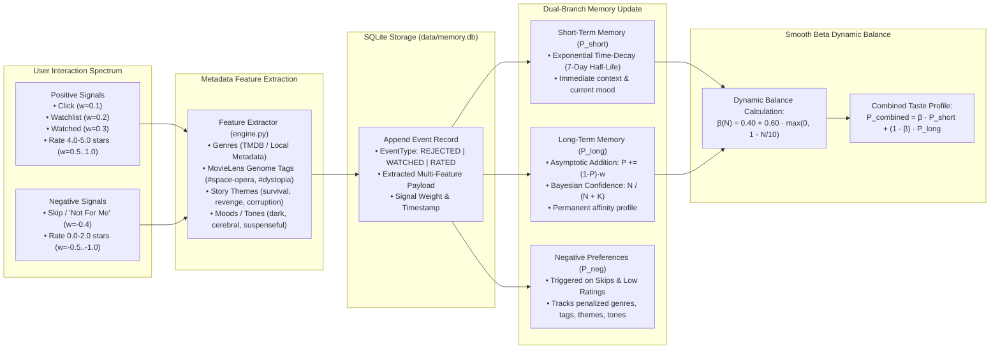
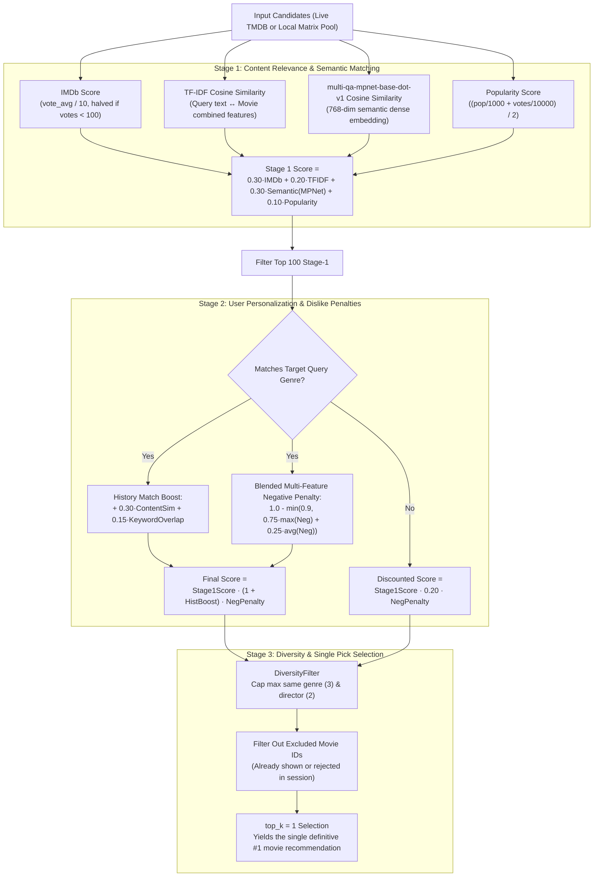
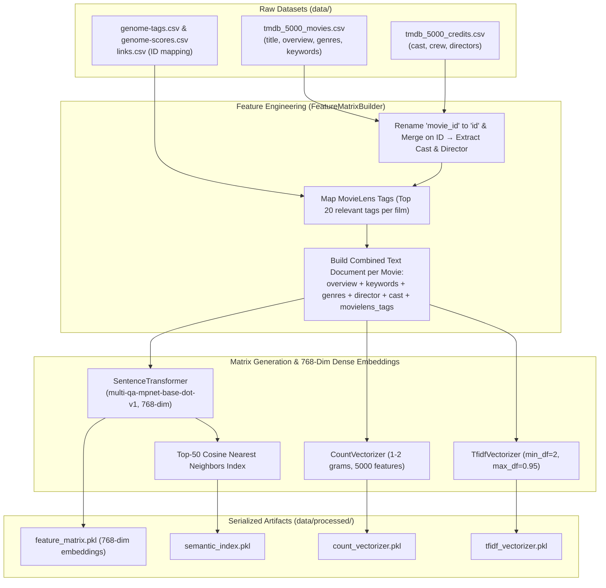

# System Architecture & Flowchart Documentation

This document describes the complete architecture, pipeline flowcharts, memory subsystems, data flow, and module responsibilities of the **Movie Recommender Agent**.

---

## 1. High-Level System Architecture

```
                    ┌──────────────┐      ┌──────────────┐      ┌──────────────┐      ┌─────────────┐
                    │  Web UI      │      │  CLI         │      │ MCP Server   │      │ A2A Agent   │
  User / Agent ─────▶│  (:8080)     │      │  (main.py)   │      │ (FastAPI     │────▶│ (3 caps)    │
   or External App  │  Showcase    │      │  Interactive │      │  :8000)      │      │             │
                    └──────┬───────┘      └──────┬───────┘      └──────┬───────┘      └──────┬──────┘
                           │                     │                     │                     │
                           ▼                     ▼                     ▼                     ▼
                ┌──────────────────────────────────────────────────────────────────────────────────┐
                │                          Pipeline: MovieRecommender                              │
                │  1. UserMemoryService: Multi-Dimensional Profile (Genres, Tags, Themes, Tones)   │
                │  2. NLFeatureExtractor: Structured TMDB discovery parameters (DeepSeek / regex)  │
                │  3. TMDBClient (or local pool): Live Discovery with Provider ID resolution       │
                │  4. Vectorization: multi-qa-mpnet-base-dot-v1 (768-dim) + TF-IDF (5,000-dim)    │
                │  5. MovieRanker.rank_movies_stage1: Query similarity + Quality + Popularity      │
                │  6. MovieRanker.rank_movies_stage2: History boost + Multi-feature Neg Penalties  │
                │  7. DiversityFilter: Genre and director frequency limits                         │
                │  8. Single Final Recommendation (top_k=1): #1 Pick + AI Verdict & Rationale      │
                │  9. Rejection Replacement Engine: Skip → Penalize Dislikes → Instant Fresh Pick │
                └──────────────┬─────────────────────────┬─────────────────────────┬───────────────┘
                               │                         │                         │
                               ▼                         ▼                         ▼
                        ┌────────────┐            ┌──────────────┐          ┌────────────────────┐
                        │ TMDB API   │            │ Offline pool │          │ LLM (DeepSeek /    │
                        │ (Live)     │            │ data/        │          │ OpenRouter)        │
                        │ Discover / │            │ processed/   │          │ Top Pick Verdict & │
                        │ Providers  │            │ feature_mat. │          │ Batch Reasoning    │
                        └────────────┘            └──────────────┘          └────────────────────┘
```

---

## 2. End-to-End Recommendation Pipeline Flowchart

```mermaid
flowchart TD
    subgraph ClientInterfaces ["1. Client Interfaces"]
        WebUI["Web UI (src/ui/web_app.py :8080)\nCinematic Single Showcase & Real-Time Skip Loop"]
        CLI["CLI (main.py)\nrecommend (top_k=1) | reject | profile | rate"]
        MCP["MCP Server (mcp_server.py)\nFastAPI :8000 (4 Tools)"]
        A2A["A2A Protocol (a2a_protocol.py)\nAgent-to-Agent (3 Capabilities)"]
    end

    subgraph InputProcessing ["2. Input & Memory Extraction"]
        UserReq["User Request\n• User ID\n• Natural Language Query\n• Session Excluded Movie IDs\n• Subscriptions / Region"]
        NLParser{"NL Query Present?"}
        LLMExtract["NLFeatureExtractor\n(DeepSeek / OpenRouter JSON parse)"]
        RegexFallback["Regex Extraction Fallback\n(Genre / Decade / Keyword scan)"]
        VocabMap["map_to_vocabulary()\nSnap keywords to model vocabulary"]
        MemoryLoad["UserMemoryService\nLoad Multi-Dimensional Profile\n(Genres, MovieLens Tags, Themes, Tones, Dislikes)"]
    end

    subgraph CandidateRetrieval ["3. Candidate Discovery"]
        TMDBCheck{"TMDB Available?"}
        LiveTMDB["TMDBClient.discover_movies()\n• Resolve numeric watch provider IDs\n• Filter: Genre, Release Dates, Runtime\n• Sort: popularity.desc / vote_average.desc\n• Exclude unwanted genres/keywords"]
        LocalPool["Local Candidate Pool\n(4,800+ Movies in data/processed/)"]
    end

    subgraph RankingEngine ["4. Two-Stage Ranking & Diversity"]
        Stage1["Stage 1: Fast Query Relevance (768-dim MPNet)\nScore = 0.30·IMDb + 0.20·TFIDF + 0.30·Semantic + 0.10·Popularity"]
        Top100["Select Top 100 Stage-1 Candidates"]
        Stage2["Stage 2: Personalization & Negative Penalties\n• Content Similarity + Keyword Overlap Boost\n• Blended Multi-Feature Negative Penalty\n(Genres + Tags + Themes + Tones)"]
        DivFilter["DiversityFilter\nCap max same genre (3) & director (2)"]
        ExcludeFilter["Exclude Session-Seen / Rejected Movie IDs"]
        Top1Select["Select Single Final #1 Candidate (top_k=1)"]
    end

    subgraph ExplanationGen ["5. Single Verdict & Decision Loop"]
        LLMVerdict{"LLM Reasoner Available?"}
        DeepSeekVerdict["DeepSeekReasoner.generate_top_pick_verdict()\nStrict Target Movie Constraint + Decisive Rationale"]
        TemplateVerdict["ReasoningTemplateEngine.generate_top_pick()\nRule-based prioritized verdict"]
        SingleShowcase["Single Recommendation Hero Card\n• Title, Poster, Match %, Rating, Year\n• MovieLens Tags, Themes, Tones, Stream\n• AI Verdict & Personalized Why-You'll-Like-It"]
        UserDecision{"User Action?"}
        Accept["Watched / Watchlist / Rate\n(Positive Interaction Event)"]
        Skip["Not For Me / Suggest Another\n(Rejection Event)"]
        LearnNeg["Learn Negative Preferences\nPenalize Disliked Movie's Tags/Themes/Tones"]
    end

    %% Client Routing
    WebUI --> UserReq
    CLI --> UserReq
    MCP --> UserReq
    A2A --> UserReq

    %% Processing
    UserReq --> NLParser
    UserReq --> MemoryLoad

    NLParser -- Yes --> LLMExtract
    LLMExtract -- Fails/No Key --> RegexFallback
    LLMExtract --> VocabMap
    RegexFallback --> VocabMap

    NLParser -- No --> MemoryLoad
    VocabMap --> TMDBCheck
    MemoryLoad --> TMDBCheck

    TMDBCheck -- Yes --> LiveTMDB
    TMDBCheck -- No / Offline --> LocalPool

    LiveTMDB --> Stage1
    LocalPool --> Stage1

    Stage1 --> Top100
    Top100 --> Stage2
    MemoryLoad -.-> Stage2
    Stage2 --> DivFilter
    DivFilter --> ExcludeFilter
    ExcludeFilter --> Top1Select

    Top1Select --> LLMVerdict
    LLMVerdict -- Yes --> DeepSeekVerdict
    LLMVerdict -- No / Error --> TemplateVerdict

    DeepSeekVerdict --> SingleShowcase
    TemplateVerdict --> SingleShowcase

    SingleShowcase --> UserDecision
    UserDecision -- Accept / Rate --> Accept
    UserDecision -- Skip / Dislike --> Skip
    Skip --> LearnNeg
    LearnNeg -.-> ExcludeFilter
```



---

## 3. Adaptive Multi-Dimensional Memory Subsystem



### Mathematical Formulations

1. **Short-Term Memory Exponential Decay:**
   $$\Delta t = t_{\text{current}} - t_{\text{event}}$$
   $$\lambda = \frac{\ln(2)}{7 \times 86400} \approx 1.1458 \times 10^{-6} \text{ s}^{-1}$$
   $$P_{\text{short}}^{(t)} = \sum_{i} w_i \cdot e^{-\lambda \cdot (t - t_i)}$$

2. **Long-Term Asymptotic Memory Addition:**
   $$P_{\text{long}}^{(t)} = P_{\text{long}}^{(t-1)} + \left(1.0 - P_{\text{long}}^{(t-1)}\right) \cdot w_{\text{new}}$$

3. **Bayesian Confidence Shrinkage:**
   $$C(N) = \frac{N}{N + K}, \quad \text{where } K = 10$$

4. **Smooth Beta Dynamic Balance:**
   $$\beta(N) = 0.40 + 0.60 \cdot \max\left(0, 1 - \frac{N}{10}\right)$$
   $$P_{\text{combined}} = \beta(N) \cdot P_{\text{short}} + (1 - \beta(N)) \cdot P_{\text{long}}$$

5. **Blended Negative Preference Penalty (Multi-Feature):**
   $$\text{PenaltyFactor} = 1.0 - \min\left(0.90, 0.75 \cdot \max_{f \in M}(\text{Neg}(f)) + 0.25 \cdot \frac{1}{|F|}\sum_{f \in M}\text{Neg}(f)\right)$$
   *Applied across all extracted candidate features: genres, MovieLens tags, themes, and tones.*

---

## 4. Two-Stage Ranking Mathematics Flowchart



---

## 5. Offline Precomputation Pipeline Flowchart



---

## 6. Architectural Component Summary

| Component | Source File | Key Responsibilities |
| :--- | :--- | :--- |
| **Interactive Web Application** | `src/ui/web_app.py`<br>`src/ui/static/index.html` | Serves FastAPI UI on `:8080` with single-movie hero showcase, real-time "Not For Me / Suggest Another" skip loop, session history strip, and multi-dimensional profile drawer. |
| **Pipeline Orchestrator** | `src/pipeline/recommender.py` | Coordinates candidate discovery, feature extraction, 2-stage ranking, diversity filtering, exclusion filtering, and single-movie recommendation delivery. |
| **Memory Subsystem** | `src/memory/service.py`<br>`src/memory/engine.py`<br>`src/memory/storage.py` | Manages SQLite event ledger (`memory.db`), 7-day half-life decay, asymptotic long-term preference updates, Smooth Beta balancing, and multi-dimensional tag/theme/tone dislike learning. |
| **Semantic Search & Vectorization** | `src/features/semantic_search.py`<br>`src/features/matrix_builder.py` | Encodes queries and items with `multi-qa-mpnet-base-dot-v1` (768-dim dense representations), builds WordNet synonym expansions, and manages TF-IDF matrices. |
| **Ranking Engine** | `src/ranking/ranker.py` | Calculates Stage 1 query relevance, Stage 2 personalization boosts, blended multi-feature negative preference penalties, and applies `DiversityFilter`. |
| **NL & Preference Extraction** | `src/llm/nl_feature_extractor.py`<br>`src/features/preference_extractor.py` | Parses natural language requests into structured TMDB parameters; extracts genre, tag, theme, and tone affinity vectors from user history. |
| **Live TMDB Client** | `src/tmdb/client.py` | Asynchronously queries TMDB REST endpoints for live movies, details, watch providers (with name-to-numeric-ID resolution), credits, and keywords. |
| **LLM Reasoning Engine** | `src/llm/reasoning.py` | Generates decisive, target-constrained #1 top pick verdicts and batch explanations (*"Because you enjoyed..."*) using DeepSeek/OpenRouter LLMs or template fallback. |
| **Interfaces (CLI, MCP, A2A)** | `main.py`<br>`mcp_server.py`<br>`a2a_protocol.py` | Exposes the recommender as a single-recommendation CLI (`main.py recommend` & `main.py reject`), an MCP server on `:8000`, or an A2A protocol endpoint. |
