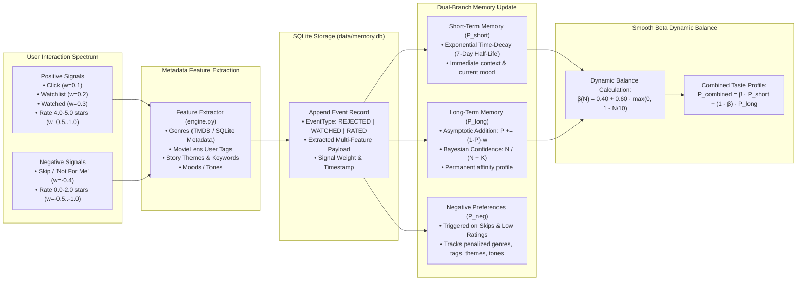
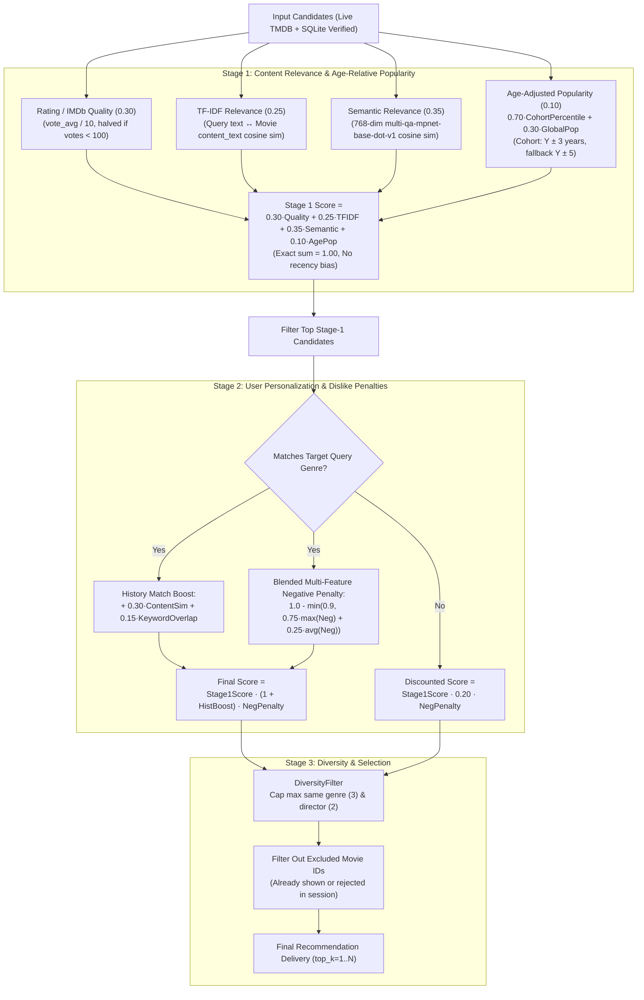
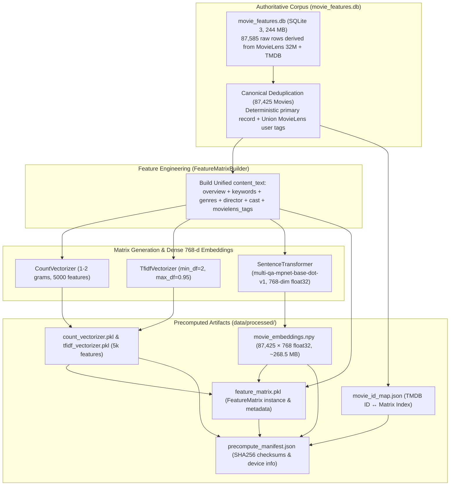

# System Architecture & Flowchart Documentation

This document describes the complete architecture, pipeline flowcharts, memory subsystems, data flow, and module responsibilities of the **Movie Recommender Agent**.

---

## 1. High-Level System Architecture

```
                    ┌──────────────┐      ┌──────────────┐      ┌──────────────┐      ┌─────────────┐
                    │  Web UI      │      │  CLI         │      │ MCP Server   │      │ A2A Agent   │
  User / Agent ─────▶│  (:8080)     │      │  (main.py)   │      │ (FastAPI     │────▶│ (3 caps)    │
   or External App  │  Showcase    │      │  Interactive │      │  :8000)      │      │             │
                    └──────┬───────┘      └──────┬───────┘      └──────┬───────┘      └──────┬──────┘
                           │                     │                     │                     │
                           ▼                     ▼                     ▼                     ▼
                ┌──────────────────────────────────────────────────────────────────────────────────┐
                │                          Pipeline: MovieRecommender                              │
                │  1. UserMemoryService: Multi-Dimensional Profile (Genres, Tags, Themes, Tones)   │
                │  2. NLFeatureExtractor: Hard vs Soft Constraint Separation (KADO / regex)        │
                │  3. TMDBClient: Live Discovery + Provider ID resolution                          │
                │  4. SQLite Filter: 87,425 Canonical Movie Membership Filter (movie_features.db)  │
                │  5. Vectorization: multi-qa-mpnet-base-dot-v1 (768-dim) + TF-IDF (5,000-dim)    │
                │  6. MovieRanker.rank_movies_stage1: 0.30 Quality + 0.25 TF-IDF + 0.35 Semantic   │
                │     + 0.10 Age-Adjusted Cohort Popularity (No Recency Bias)                      │
                │  7. MovieRanker.rank_movies_stage2: History boost + Multi-feature Neg Penalties  │
                │  8. DiversityFilter: Genre and director frequency limits                         │
                │  9. Single Final Recommendation (top_k=1): #1 Pick + AI Verdict & Rationale      │
                │ 10. Rejection Replacement Engine: Skip → Learn Dislikes → Instant Fresh Pick    │
                └──────────────┬─────────────────────────┬─────────────────────────┬───────────────┘
                               │                         │                         │
                               ▼                         ▼                         ▼
                        ┌────────────┐            ┌──────────────┐          ┌────────────────────┐
                        │ TMDB API   │            │ SQLite Corpus│          │ LLM (Kado OpenAI-  │
                        │ (Live)     │            │ movie_       │          │ compatible /       │
                        │ Discover / │            │ features.db  │          │ DeepSeek fallback) │
                        │ Providers  │            │ (87,425 recs)│          │ Verdict & Reasons  │
                        └────────────┘            └──────────────┘          └────────────────────┘
```

---

## 2. End-to-End Recommendation Pipeline Flowchart

```mermaid
flowchart TD
    subgraph ClientInterfaces ["1. Client Interfaces"]
        WebUI["Web UI (src/ui/web_app.py :8080)\nCinematic Single Showcase, User Persistence & Skip Loop"]
        CLI["CLI (main.py)\nrecommend (top_k=1) | reject | profile | rate"]
        MCP["MCP Server (mcp_server.py)\nFastAPI :8000 (4 Tools)"]
        A2A["A2A Protocol (a2a_protocol.py)\nAgent-to-Agent (3 Capabilities)"]
    end

    subgraph InputProcessing ["2. Input & Memory Extraction"]
        UserReq["User Request\n• User ID\n• Natural Language Query\n• Session Excluded Movie IDs\n• Subscriptions / Region"]
        NLParser{"NL Query Present?"}
        LLMExtract["NLFeatureExtractor\n(Kado OpenAI-compatible JSON parse)"]
        RegexFallback["Regex Extraction Fallback\n(Genre / Decade / Keyword scan)"]
        ConstraintSplit["Constraint Separation:\n• Hard: explicit genres, actors, directors, years, language, adult\n• Soft: moods, themes, plot concepts → semantic query"]
        VocabMap["map_to_vocabulary()\nSnap keywords to model vocabulary"]
        MemoryLoad["UserMemoryService\nLoad Multi-Dimensional Profile\n(Genres, Tags, Themes, Tones, Dislikes)"]
    end

    subgraph CandidateRetrieval ["3. Candidate Discovery & Database Filter"]
        TMDBCheck{"TMDB Available?"}
        LiveTMDB["TMDBClient.discover_movies()\n• Resolve numeric watch provider IDs\n• Query ONLY with explicit hard constraints\n• Multi-page discovery top-up (up to 5 pages)"]
        LocalPool["SQLite Local Pool\n(87,425 Canonical Movies in movie_features.db)"]
        SQLiteFilter["SQLite Membership Filter\nDrop candidates absent from movie_features.db"]
    end

    subgraph RankingEngine ["4. Two-Stage Ranking & Diversity"]
        Stage1["Stage 1: Linear Multi-Signal Scoring (Exact Weights)\nScore = 0.30·Quality + 0.25·TFIDF + 0.35·Semantic + 0.10·AgePop\n(AgePop = 0.70·CohortPercentile + 0.30·GlobalPop)"]
        TopCandidates["Select Top Stage-1 Candidates (default 100)"]
        Stage2["Stage 2: Personalization & Negative Penalties\n• Content Similarity + Keyword Overlap Boost\n• Blended Multi-Feature Negative Penalty\n(Genres + Tags + Themes + Tones)"]
        DivFilter["DiversityFilter\nCap max same genre (3) & director (2)"]
        ExcludeFilter["Exclude Session-Seen / Rejected Movie IDs"]
        TopSelect["Select Top-K or Single Final Candidate (top_k=1)"]
    end

    subgraph ExplanationGen ["5. Single Verdict & Decision Loop"]
        LLMVerdict{"LLM Reasoner Available?"}
        KadoVerdict["DeepSeekReasoner (Kado LLM)\nTarget Movie Constraint + Decisive Rationale"]
        TemplateVerdict["ReasoningTemplateEngine\nRule-based prioritized verdict"]
        SingleShowcase["Single Recommendation Hero Card\n• Title, Poster, Match %, Rating, Year\n• Tags, Genres, Real Watch Providers\n• AI Verdict & Personalized Why-You'll-Like-It"]
        UserDecision{"User Action?"}
        Accept["Watched / Watchlist / Rate\n(Positive Interaction Event)"]
        Skip["Not For Me / Suggest Another\n(Rejection Event)"]
        LearnNeg["Learn Negative Preferences\nPenalize Disliked Movie Features in Memory Ledger"]
    end

    %% Client Routing
    WebUI --> UserReq
    CLI --> UserReq
    MCP --> UserReq
    A2A --> UserReq

    %% Processing
    UserReq --> NLParser
    UserReq --> MemoryLoad

    NLParser -- Yes --> LLMExtract
    LLMExtract -- Fails/No Key --> RegexFallback
    LLMExtract --> ConstraintSplit
    RegexFallback --> ConstraintSplit
    ConstraintSplit --> VocabMap

    NLParser -- No --> MemoryLoad
    VocabMap --> TMDBCheck
    MemoryLoad --> TMDBCheck

    TMDBCheck -- Yes --> LiveTMDB --> SQLiteFilter
    TMDBCheck -- No / Offline --> LocalPool --> SQLiteFilter

    SQLiteFilter --> Stage1
    Stage1 --> TopCandidates
    TopCandidates --> Stage2
    MemoryLoad -.-> Stage2
    Stage2 --> DivFilter
    DivFilter --> ExcludeFilter
    ExcludeFilter --> TopSelect

    TopSelect --> LLMVerdict
    LLMVerdict -- Yes --> KadoVerdict
    LLMVerdict -- No / Error --> TemplateVerdict

    KadoVerdict --> SingleShowcase
    TemplateVerdict --> SingleShowcase

    SingleShowcase --> UserDecision
    UserDecision -- Accept / Rate --> Accept
    UserDecision -- Skip / Dislike --> Skip
    Skip --> LearnNeg
    LearnNeg -.-> ExcludeFilter
```



---

## 3. Adaptive Multi-Dimensional Memory Subsystem



### Mathematical Formulations

1. **Short-Term Memory Exponential Decay:**
   $$\Delta t = t_{\text{current}} - t_{\text{event}}$$
   $$\lambda = \frac{\ln(2)}{7 \times 86400} \approx 1.1458 \times 10^{-6} \text{ s}^{-1}$$
   $$P_{\text{short}}^{(t)} = \sum_{i} w_i \cdot e^{-\lambda \cdot (t - t_i)}$$

2. **Long-Term Asymptotic Memory Addition:**
   $$P_{\text{long}}^{(t)} = P_{\text{long}}^{(t-1)} + \left(1.0 - P_{\text{long}}^{(t-1)}\right) \cdot w_{\text{new}}$$

3. **Bayesian Confidence Shrinkage:**
   $$C(N) = \frac{N}{N + K}, \quad \text{where } K = 10$$

4. **Smooth Beta Dynamic Balance:**
   $$\beta(N) = 0.40 + 0.60 \cdot \max\left(0, 1 - \frac{N}{10}\right)$$
   $$P_{\text{combined}} = \beta(N) \cdot P_{\text{short}} + (1 - \beta(N)) \cdot P_{\text{long}}$$

5. **Blended Negative Preference Penalty (Multi-Feature):**
   $$\text{PenaltyFactor} = 1.0 - \min\left(0.90, 0.75 \cdot \max_{f \in M}(\text{Neg}(f)) + 0.25 \cdot \frac{1}{|F|}\sum_{f \in M}\text{Neg}(f)\right)$$
   *Applied across all extracted candidate features: genres, user tags, themes, and keywords.*

---

## 4. Two-Stage Ranking Mathematics & Flowchart



### Stage 1 Age-Relative Popularity Math

$$\text{Rating Count Metric} = \log(1 + \text{rating\_count})$$

- **Release-Year Cohort:** Evaluated within a window of $Y \pm 3$ years. If fewer than 20 movies exist in the primary cohort, expands to $Y \pm 5$ years. If still sparse or release year is missing, safely falls back to global popularity.
- **Cohort Percentile:** Percentile rank of $\log(1 + \text{rating\_count})$ within the active release-year cohort:
  $$\text{CohortPercentile} = \frac{\sum_{m \in \text{Cohort}} \mathbb{I}(\log(1 + \text{count}_m) < \log(1 + \text{count}))}{\max(1, |\text{Cohort}| - 1)}$$
- **Global Popularity:**
  $$\text{GlobalPop} = \frac{\log(1 + \text{rating\_count})}{\log(1 + \text{global\_max\_rating\_count})}$$
- **Age-Adjusted Popularity:**
  $$\text{AgeAdjustedPop} = 0.70 \times \text{CohortPercentile} + 0.30 \times \text{GlobalPop}$$

---

## 5. Offline Precomputation Architecture



---

## 6. Architectural Component Summary

| Component | Source File | Key Responsibilities |
| :--- | :--- | :--- |
| **Interactive Web Application** | `src/ui/web_app.py`<br>`src/ui/static/index.html` | Serves FastAPI UI on `:8080` with single-movie hero showcase, user persistence in localStorage, real-time skip/feedback loop, session history strip, factual provider badges, and preference drawer. |
| **Pipeline Orchestrator** | `src/pipeline/recommender.py` | Coordinates candidate discovery, constraint separation, SQLite membership filtering, 2-stage ranking, diversity filtering, exclusion filtering, and single-movie recommendation delivery. |
| **Memory Subsystem** | `src/memory/service.py`<br>`src/memory/engine.py`<br>`src/memory/storage.py` | Manages SQLite event ledger (`memory.db`), 7-day half-life decay, asymptotic long-term preference updates, Smooth Beta balancing, and multi-dimensional dislike learning. |
| **Semantic Search & Vectorization** | `src/features/semantic_search.py`<br>`src/features/matrix_builder.py` | Encodes queries and items with `multi-qa-mpnet-base-dot-v1` (768-dim dense representations), builds WordNet synonym expansions, manages TF-IDF matrices, and performs fast on-demand cosine similarity. |
| **Ranking Engine** | `src/ranking/ranker.py` | Calculates Stage 1 query relevance with exact linear weights (0.30 rating, 0.25 TF-IDF, 0.35 semantic, 0.10 age-adjusted popularity), Stage 2 personalization boosts, blended multi-feature negative penalties, and applies `DiversityFilter`. |
| **NL & Preference Extraction** | `src/llm/nl_feature_extractor.py`<br>`src/features/preference_extractor.py` | Separates natural language requests into explicit hard constraints for TMDB and soft semantic concepts for downstream vector search; extracts user affinity vectors from history. |
| **Live TMDB Client** | `src/tmdb/client.py` | Asynchronously queries TMDB REST endpoints for live movies, details, watch providers (with name-to-numeric-ID resolution), credits, and keywords. |
| **LLM Reasoning Engine** | `src/llm/reasoning.py` | Generates decisive, target-constrained #1 top pick verdicts and batch explanations using Kado OpenAI-compatible API or template fallback. |
| **Interfaces (CLI, MCP, A2A)** | `main.py`<br>`mcp_server.py`<br>`a2a_protocol.py` | Exposes the recommender as a single-recommendation CLI (`main.py recommend`), interactive UI (`main.py ui`), MCP server on `:8000`, or A2A protocol endpoint. |
